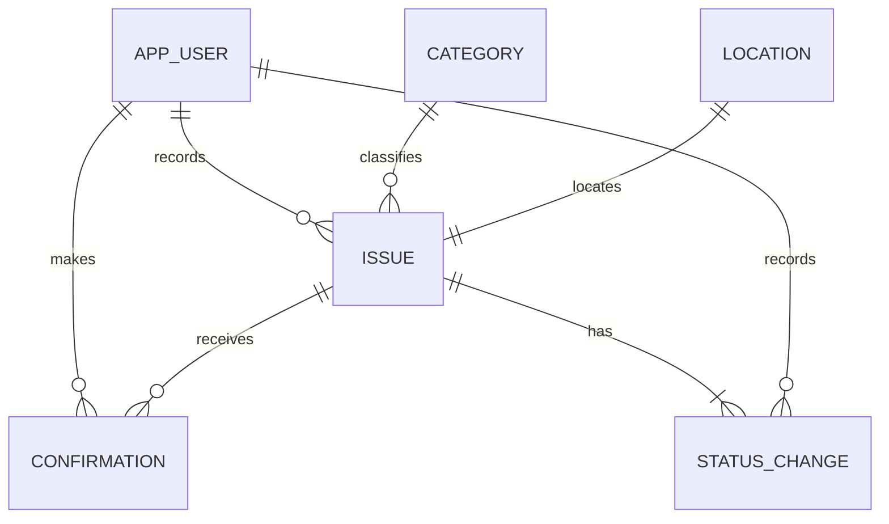
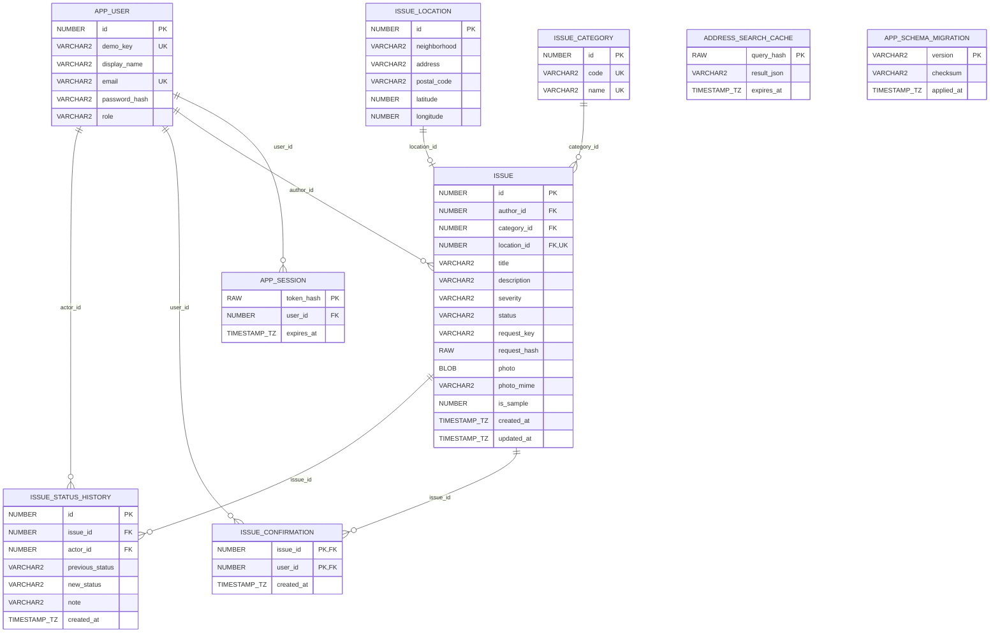

# Modelagem de dados

## MER conceitual

Cada ocorrência tem uma categoria, um autor cidadão e uma localização própria. O par ocorrência e cidadão identifica uma confirmação. O histórico começa no registro e cresce a cada transição feita por um agente comunitário ou pelo encerramento solicitado pelo autor.

## DER físico

- `ISSUE` tem unicidade em `(author_id, request_key)`. A repetição com o mesmo conteúdo recupera a ocorrência existente. Com conteúdo diferente, retorna conflito.
- `ISSUE_LOCATION` mantém as coordenadas dentro dos limites geográficos. `CREATE_ISSUE` exige latitude e longitude para todas as novas ocorrências. O CEP, quando informado, é armazenado com oito dígitos. A descrição da ocorrência pode ficar vazia. A rotina cria localização, ocorrência, foto BLOB e histórico inicial na mesma transação.
- `ISSUE_CONFIRMATION` tem chave primária composta. Confirmações e mudanças de status bloqueiam a mesma linha da ocorrência antes de validar o estado. Uma ocorrência resolvida permite ao cidadão remover a própria confirmação existente.
- `PKG_ISSUES` aceita o fluxo do agente `OPEN → IN_PROGRESS → RESOLVED`. `CLOSE_ISSUE` permite exclusivamente ao autor passar de `OPEN` ou `IN_PROGRESS` para `CLOSED`, sem remover dados. Cada transição grava responsável, data e observação opcional no histórico. Encerramento é idempotente e bloqueia novas confirmações e transições de status. Os indicadores distinguem `closed` de `resolved`.
- `CALCULATE_PRIORITY` usa `10 × peso da gravidade + 2 × confirmações`. Os pesos de `LOW`, `MEDIUM` e `HIGH` são 1, 2 e 3. O total de confirmações e a pontuação são calculados nas consultas.
- As procedures não fazem `COMMIT`. A API confirma ou desfaz a transação e usa transação somente leitura para detalhes e indicadores com múltiplas consultas. Os três cursores de indicadores são fechados antes da devolução da conexão ao pool.
- `APP_SCHEMA_MIGRATION` registra versão, checksum e conclusão. Execute um migrador por vez. O runner verifica conflitos antes de iniciar cada migração e pode retomar a criação após uma interrupção. O seed insere chaves estáveis e preserva os exemplos existentes, inclusive seus históricos e confirmações.

- Contas públicas são criadas como `CITIZEN`. A moderação concede ou revoga `OPERATOR` de uma conta cadastrada. `APP_SESSION` armazena o hash do token e sua expiração. Autores históricos da demonstração preservam seus vínculos e não têm credenciais para login.

- `LOCATE_ISSUE` bloqueia a ocorrência, permite que o autor ou um agente forneça coordenadas quando o ponto ainda está vazio e mantém o endereço registrado. O backend controla a transação.
- `ADDRESS_SEARCH_CACHE` guarda as alternativas externas de uma consulta normalizada por hash, com expiração. O JSON representa uma resposta externa cacheada. As localizações confirmadas permanecem nas colunas relacionais de `ISSUE_LOCATION`.

- Os cinco registros de exemplo herdados receberam posições ilustrativas por suas chaves estáveis. Registros reais são preservados. Novos cadastros exigem coordenadas na validação compartilhada e no package PL/SQL.
- `LOCATE_ISSUE` também preenche bairro, endereço e CEP disponível quando o autor ou um agente completa uma localização antiga.
