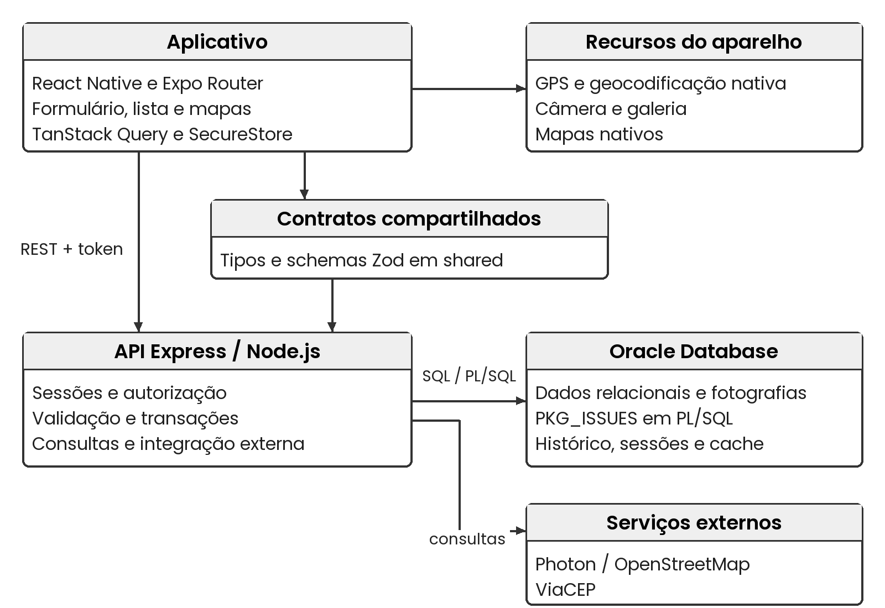
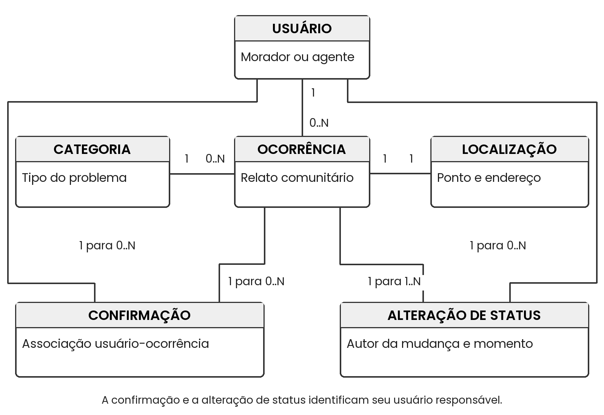
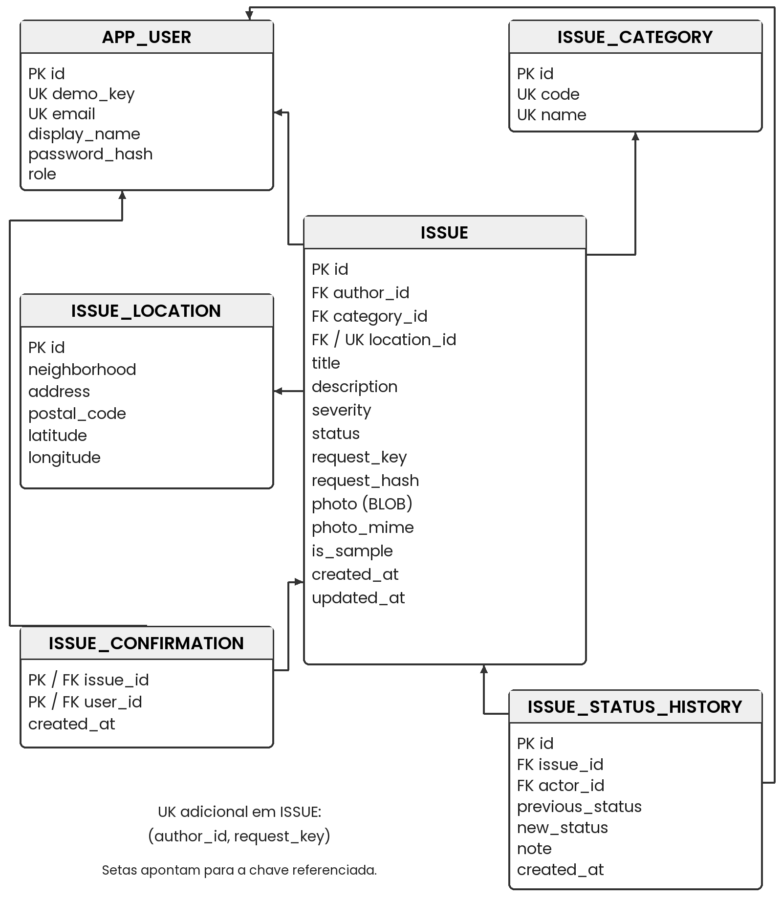
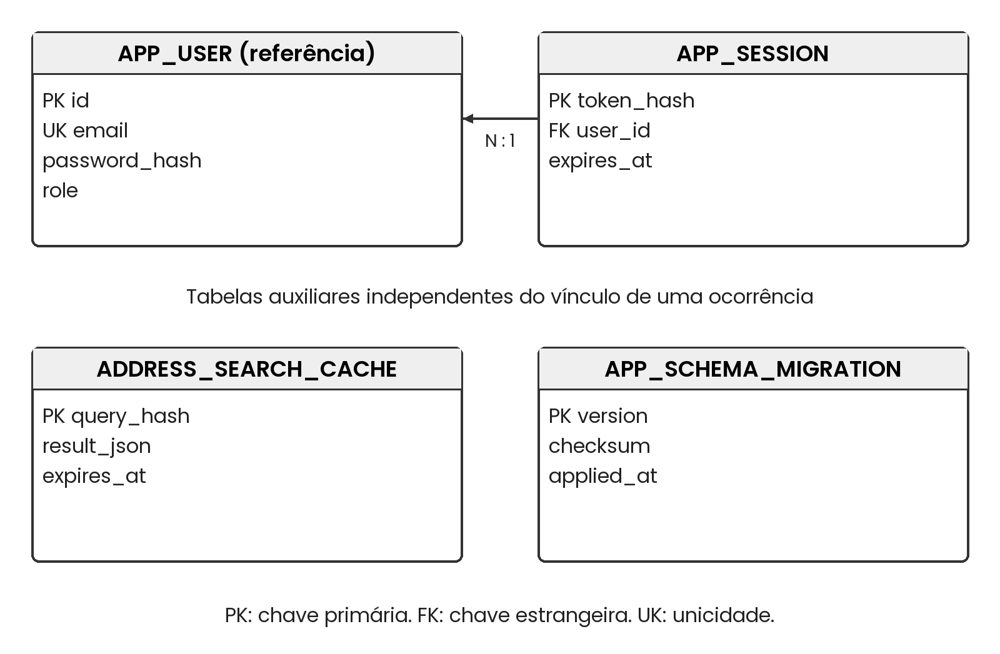

# Global Solution 2 - BairroAtivo

## Introdução

O BairroAtivo é um aplicativo comunitário para registrar e acompanhar problemas de infraestrutura urbana. Seu objetivo é reunir relatos de moradores, localização, fotografias, confirmações e histórico de acompanhamento em uma interface simples, permitindo que a comunidade visualize o que acontece nos espaços que utiliza diariamente.

O problema que motivou o projeto é a dispersão de informações sobre buracos, iluminação inadequada, calçadas danificadas, resíduos, drenagem e equipamentos públicos. Um relato isolado em uma conversa pode perder contexto, não indicar o local com clareza e dificultar a identificação de problemas que continuam afetando outras pessoas.

A proposta atende ao desafio CitizenTech da Global Solution 2 de 2026 ao colocar as necessidades do cidadão no centro da solução. A tecnologia é aplicada para organizar evidências, dar visibilidade aos relatos e apoiar o acompanhamento comunitário. O vínculo principal é com o ODS 11, relacionado a cidades e comunidades sustentáveis.

O escopo funcional implementado contempla:

- Registro de ocorrências em seis categorias de infraestrutura urbana, com título, gravidade, descrição opcional e fotografia opcional;

- Localização por endereço escolhido pelo usuário ou pela posição do aparelho, com preenchimento de dados disponíveis e conferência do CEP;

- Exploração em lista paginada e mapa, com busca, filtros por categoria, status e período, além de ordenação por data ou prioridade;

- Confirmação comunitária da permanência de um problema e cálculo explicável da prioridade;

- Acompanhamento por agentes autorizados, histórico de alterações e encerramento pelo próprio autor;

- Indicadores por status, categoria e bairro;

- Cadastro, autenticação, perfil e sessões revogáveis como recursos de apoio ao funcionamento do aplicativo.

Login e cadastro não são contabilizados como funcionalidades principais da proposta. O valor do aplicativo está nos fluxos de registro, exploração geográfica, confirmação, acompanhamento e geração de indicadores.

O produto entregue é um protótipo funcional com persistência real em Oracle e interface React Native. Os registros permanecem na plataforma comunitária: não existe encaminhamento automático à prefeitura, protocolo oficial de atendimento ou garantia de execução de serviços públicos.

## Fundamentação teórica

A fundamentação do BairroAtivo está baseada em participação cidadã, organização da informação territorial, acessibilidade digital e consistência de dados. Esses conceitos orientam tanto a proposta social quanto as decisões de implementação.

CitizenTech é tratado neste projeto conforme o contexto do enunciado: tecnologia voltada a necessidades concretas das pessoas. Em vez de exigir que o morador compreenda estruturas administrativas ou procedimentos técnicos, o aplicativo permite descrever um problema, indicar onde ele está e acompanhar sua evolução com linguagem direta.

O ODS 11 das Nações Unidas propõe cidades e comunidades inclusivas, seguras, resilientes e sustentáveis. O BairroAtivo se relaciona especialmente à meta 11.3, sobre planejamento e gestão participativos, e à meta 11.7, sobre espaços públicos seguros, inclusivos e acessíveis. Registrar barreiras no passeio, iluminação inadequada e conservação de espaços pode apoiar a identificação dessas necessidades. A contribuição é potencial e não representa comprovação de melhoria urbana já produzida pelo protótipo.

A informação territorial combina a descrição do morador com coordenadas e referências de endereço. O GPS fornece uma posição; rua, bairro e CEP dependem de bases de geocodificação. Por isso, o aplicativo permite conferir o ponto e editar o CEP, além de evitar combinar dados de municípios diferentes. Ruas internas de condomínios e locais pouco mapeados podem permanecer sem CEP confirmado.

A participação comunitária também exige rastreabilidade. Uma confirmação não substitui uma avaliação técnica e não comprova, por si só, a gravidade de um problema. No projeto, ela funciona como indicação de que outras pessoas reconhecem sua permanência, compondo uma pontuação simples e transparente.

A acessibilidade orienta a apresentação de rótulos, mensagens de erro, controles identificáveis e status descritos por texto e cor. As recomendações da W3C sobre alternativas textuais e uso de cor são referências de projeto. A implementação possui recursos de apoio a leitores de tela, mas ainda necessita de uma avaliação específica de acessibilidade e de testes com públicos diversos antes de qualquer afirmação de conformidade.

A consistência dos registros é sustentada por um banco relacional e por transações. Chaves, restrições e rotinas PL/SQL protegem relações entre ocorrência, localização, autor, confirmações e histórico. Essa abordagem reduz a possibilidade de um fluxo ser apresentado como concluído quando apenas parte dos dados foi gravada.

## Storytelling e ideação

Para representar o público beneficiado, foi construída a persona fictícia de Ana, moradora que percorre diariamente seu bairro para trabalhar e acompanhar familiares. Em seu caminho, ela encontra uma calçada irregular, uma luminária apagada e um ponto com água acumulada após a chuva.

Antes de utilizar o BairroAtivo, Ana poderia comentar a situação em um grupo de mensagens, mas o relato ficaria misturado a outros assuntos. Uma pessoa que chegasse depois teria dificuldade para identificar o endereço, saber se o problema ainda existe ou encontrar alguma atualização.

No aplicativo, Ana escolhe a categoria, escreve um título, informa a gravidade e seleciona o local pelo endereço ou pela posição do aparelho. Quando necessário, pode fotografar a situação na hora ou escolher uma imagem da galeria. A descrição permanece opcional para reduzir o esforço de registro.

Outro morador visualiza o ponto no mapa ou encontra a ocorrência pela busca e confirma que o problema continua. A pontuação de prioridade é atualizada a partir da gravidade informada e das confirmações, sem classificação por inteligência artificial ou critério oculto.

Um agente comunitário autorizado pode iniciar o acompanhamento e, posteriormente, marcar o registro como resolvido. Cada mudança fica no histórico. Se Ana decidir interromper o acompanhamento de um relato próprio, poderá encerrá-lo com motivo opcional; o registro continuará disponível para consulta.

A ideação evoluiu de um formulário de relatos para um fluxo completo de participação. Durante o refinamento, foram incorporados câmera, mapas, preenchimento de endereço e CEP, filtros de data, paginação, perfis reais, moderação de agentes e tratamento de falhas de localização. O resultado esperado é reduzir a perda de contexto e tornar o acompanhamento mais claro para a comunidade.

## Metodologia

O desenvolvimento adotou uma abordagem incremental, organizada por fluxos completos de uso. As solicitações foram tratadas em ciclos de definição da necessidade, ajuste de interface e contrato da API, implementação das regras, persistência e validação. A descrição metodológica corresponde à evolução técnica do protótipo e não pressupõe a realização de entrevistas ou pesquisa de campo já concluída.

As etapas de desenvolvimento foram:

1. Delimitação do problema: escolha de ocorrências de infraestrutura urbana e dos moradores como público principal;

1. Definição do MVP: seleção dos fluxos de registro, exploração, confirmação, acompanhamento e indicadores;

1. Modelagem de dados: definição de entidades, cardinalidades, restrições, autenticação e histórico;

1. Implementação da persistência: criação do esquema Oracle, migrações e package PL/SQL;

1. Construção da API: autenticação, autorização, contratos, validação, operações transacionais e consultas paginadas;

1. Construção da interface: navegação, formulário, câmera, mapas, filtros, perfil e mensagens de estado;

1. Refinamento orientado ao uso: correções de localização e CEP, encerramento pelo autor, prioridade visível e controle da rolagem e atualização da lista;

1. Validação: testes unitários, integração HTTP com Oracle, suíte PL/SQL e interação no simulador iOS;

1. Documentação: organização das justificativas, modelos, catálogo técnico, instruções de execução e materiais para o repositório.

As principais hipóteses verificadas tecnicamente foram:

- Uma nova ocorrência deve possuir coordenadas, independentemente de o usuário escolher um endereço ou usar o GPS;

- A repetição de um envio não deve criar relatos duplicados;

- Um morador não pode executar transições reservadas ao agente, e somente o autor pode encerrar sua ocorrência;

- Uma confirmação deve ser única por morador e ocorrência;

- Ocorrências resolvidas ou encerradas não devem receber novas confirmações;

- A paginação e os filtros devem ser aplicados pelo banco, sem depender do envio de toda a base ao aparelho;

- O CEP não deve ser preenchido automaticamente com dados incompatíveis com o município identificado para a posição;

- A consulta de registros encerrados deve continuar disponível, mesmo quando eles estão ocultos na visualização padrão.

A validação atual demonstra o funcionamento técnico do protótipo. Medidas de adesão, compreensão, acessibilidade e impacto social ainda precisam ser obtidas em um piloto com moradores e agentes reais. O repositório GitHub será acrescentado pela equipe após sua criação.

## Tecnologias utilizadas

### Desenvolvimento

- React Native 0.88 e React 19.3 para a interface do aplicativo;

- Expo SDK 58 e Expo Router para execução, integração com o aparelho e navegação;

- TypeScript no aplicativo, na API e nos contratos compartilhados;

- Node.js 24 ou superior e Express 5 para a API REST;

- Zod para validação de entradas e contratos de localização;

- React Hook Form para organização dos campos e dos erros do formulário;

- TanStack Query 5 para consultas, cache em memória, invalidação e controle das atualizações;

- Componentes reutilizáveis de interface, tema e tipografia DM Sans no aplicativo.

### Banco de dados e automação

- Oracle Database Free com serviço FREEPDB1 e esquema BAIRROATIVO;

- Driver node-oracledb 26 em modo Thin, com pool de conexões;

- SQL relacional, índices, chaves e restrições para integridade dos dados;

- Package PKG_ISSUES em PL/SQL para registro, confirmações, transições, encerramento e indicadores;

- Migrações versionadas de 001 a 008 e controle de checksum em APP_SCHEMA_MIGRATION.

### Localização, fotografias e segurança

- Expo Location para posição e geocodificação nativa;

- Photon/OpenStreetMap para busca e consulta reversa de endereços;

- ViaCEP para conferir município e UF de um CEP sugerido na localização;

- React Native Maps no aplicativo nativo e Leaflet com mapas OpenStreetMap na versão web;

- Expo Image Picker para câmera e galeria, e Image Manipulator para reduzir e comprimir imagens;

- Expo SecureStore para o token no aplicativo nativo; sessionStorage na versão web;

- Scrypt com sal aleatório para senhas e SHA-256 para o hash de tokens e requisições;

- Limites de requisição em rotas de autenticação e localização, validação de conteúdo e limite de fotografia.

### Infraestrutura e qualidade

- Docker para o Oracle no ambiente local; a imagem utilizada é container-registry.oracle.com/database/free:latest-lite;

- NPM workspaces para organizar mobile, server e shared;

- Variáveis de ambiente com arquivos de exemplo sem credenciais reais;

- Node Test Runner para testes unitários e de integração;

- TypeScript, ESLint e Prettier para verificação estática e padronização;

- Documentação em Markdown, README.txt e modelos de dados.

Não há componente de inteligência artificial na implementação atual. A prioridade é determinística e a consulta de endereço utiliza serviços de geocodificação. O protótipo também não possui publicação em lojas, integração oficial com órgãos públicos, operação offline com sincronização ou pipeline de implantação automatizado.

## Arquitetura e casos de uso

O BairroAtivo utiliza uma arquitetura cliente-servidor com API modular. O aplicativo React Native apresenta os fluxos e solicitações do cidadão. A API Express autentica a sessão, valida os dados, aplica a autorização e coordena o acesso ao Oracle. O package PL/SQL mantém as regras que precisam permanecer protegidas no banco.

O diretório shared concentra tipos e validações usados pelo aplicativo e pelo servidor. As integrações Photon e ViaCEP são intermediadas pela API, enquanto a obtenção da posição, a geocodificação nativa, a câmera e os mapas nativos utilizam os recursos do aparelho. Na web, o mapa utiliza Leaflet.


Figura 1 - Organização dos componentes do BairroAtivo. Fonte: elaboração do projeto.

### Casos de uso e regras principais

| Caso de uso             | Comportamento e tecnologias aplicadas                                                                                                                  |
| ----------------------- | ------------------------------------------------------------------------------------------------------------------------------------------------------ |
| Registrar ocorrência    | Morador informa categoria, título, gravidade e localização. Descrição e foto são opcionais. React Native, validação compartilhada, API e CREATE_ISSUE. |
| Localizar ocorrência    | Usuário escolhe um candidato de endereço ou usa a posição do aparelho. Expo Location, Photon, ViaCEP e cache Oracle.                                   |
| Explorar relatos        | Busca e filtros por categoria, status e datas. Lista com 15 itens por página e mapa em lotes de 50. SQL aplica os filtros antes da paginação.          |
| Confirmar permanência   | Morador confirma uma vez por ocorrência e pode retirar a confirmação. ADD_CONFIRMATION e REMOVE_CONFIRMATION protegem as regras.                       |
| Acompanhar atendimento  | Agente autorizado muda de Aberta para Em acompanhamento e depois Resolvida. UPDATE_ISSUE_STATUS registra o histórico.                                  |
| Encerrar relato próprio | Autor encerra uma ocorrência aberta ou em acompanhamento. CLOSE_ISSUE mantém o registro, a fotografia, as confirmações e o histórico.                  |
| Consultar indicadores   | Totais por status, categoria e bairro obtidos por GET_COMMUNITY_METRICS e apresentados na área de indicadores.                                         |
| Gerenciar conta         | Cadastro público como morador, login, edição de nome e logout. Agentes são concedidos somente pela moderação.                                          |

As seis categorias são Vias públicas, Iluminação pública, Calçadas e acessibilidade, Resíduos e limpeza, Drenagem e Equipamentos públicos. A gravidade assume LOW, MEDIUM ou HIGH. O status assume OPEN, IN_PROGRESS, RESOLVED ou CLOSED, apresentado ao usuário como Aberta, Em acompanhamento, Resolvida ou Encerrada.

Em Explorar, as encerradas são ocultadas por padrão, inclusive no mapa. O filtro Encerrada permite consultá-las e a opção Todos inclui todos os status. Meus registros mantém o histórico completo do autor. O encerramento não deve ser confundido com resolução técnica do problema.

### Requisitos funcionais e critérios de aceite

| Requisito                        | Critério de aceite                                                                                                                   |
| -------------------------------- | ------------------------------------------------------------------------------------------------------------------------------------ |
| RF01 - Registro georreferenciado | Recusar criação sem coordenadas e aceitar localização por qualquer uma das duas opções disponíveis.                                  |
| RF02 - Fotografia opcional       | Permitir câmera ou galeria, com tratamento de permissão e validação de arquivo de até 5 MiB na API.                                  |
| RF03 - Exploração e filtros      | Aplicar busca, status, categoria e período de forma consistente em lista e mapa. Datas completas atualizam o filtro automaticamente. |
| RF04 - Participação comunitária  | Impedir confirmação duplicada e novas confirmações em registros resolvidos ou encerrados.                                            |
| RF05 - Controle de acesso        | Impedir promoção pública a agente, transição por morador e encerramento por outro usuário.                                           |
| RF06 - Histórico e indicadores   | Registrar responsável e momento de cada transição e refletir os quatro status nos indicadores.                                       |
| RF07 - Encerramento preservado   | Manter a ocorrência acessível e evitar duplicar o histórico quando o autor repetir a solicitação de encerramento.                    |
| RF08 - Prioridade explicável     | Exibir a pontuação em cada item e ordenar por ela quando o usuário selecionar Prioridade.                                            |

### Modelagem de dados: MER e DER

O modelo conceitual representa o domínio comunitário: usuário, ocorrência, categoria, localização, confirmação e alteração de status. As entidades técnicas de sessão, cache e migração aparecem no modelo físico, pois apoiam autenticação, eficiência e evolução do esquema.


Figura 2 - MER conceitual do domínio comunitário. Fonte: elaboração do projeto.

Um usuário pode registrar nenhuma ou várias ocorrências; cada ocorrência possui um autor. Uma categoria classifica nenhuma ou várias ocorrências, e cada ocorrência utiliza uma categoria. Cada ocorrência possui uma localização própria e recebe nenhuma ou várias confirmações. A associação entre usuário e ocorrência é resolvida por CONFIRMATION. O histórico possui ao menos a abertura e pode receber outras alterações, cada uma vinculada ao responsável.


Figura 3 - DER do núcleo de ocorrências. PK: chave primária; FK: chave estrangeira; UK: unicidade. Fonte: elaboração do projeto.


Figura 4 - DER de autenticação e tabelas de apoio. APP_USER é referência à entidade da Figura 3. Fonte: elaboração do projeto.

| Entidade física      | Chaves e atributos principais                                                                                                                                                           | Finalidade                                                                                                           |
| -------------------- | --------------------------------------------------------------------------------------------------------------------------------------------------------------------------------------- | -------------------------------------------------------------------------------------------------------------------- |
| APP_USER             | id (PK), demo_key (UK), email (UK), display_name, password_hash e role.                                                                                                                 | Identifica moradores, agentes e autores históricos. Contas públicas recebem CITIZEN.                                 |
| APP_SESSION          | token_hash (PK), user_id (FK) e expires_at.                                                                                                                                             | Controla sessões revogáveis sem armazenar o token original no banco.                                                 |
| ISSUE_CATEGORY       | id (PK), code (UK) e name (UK).                                                                                                                                                         | Mantém as seis categorias de infraestrutura.                                                                         |
| ISSUE_LOCATION       | id (PK), neighborhood, address, postal_code, latitude e longitude.                                                                                                                      | Armazena o local confirmado para uma ocorrência.                                                                     |
| ISSUE                | id (PK), author_id (FK), category_id (FK), location_id (FK/UK), title, description, severity, status, request_key, request_hash, photo, photo_mime, is_sample, created_at e updated_at. | Representa o relato e preserva os dados de criação e atualização.                                                    |
| ISSUE_CONFIRMATION   | issue_id e user_id (PK composta e FKs), created_at.                                                                                                                                     | Garante uma confirmação por morador e ocorrência.                                                                    |
| ISSUE_STATUS_HISTORY | id (PK), issue_id (FK), actor_id (FK), previous_status, new_status, note e created_at.                                                                                                  | Mantém a abertura e as alterações de acompanhamento.                                                                 |
| ADDRESS_SEARCH_CACHE | query_hash (PK), result_json e expires_at.                                                                                                                                              | Guarda respostas temporárias de geocodificação e consulta de CEP. Não substitui a localização relacional confirmada. |
| APP_SCHEMA_MIGRATION | version (PK), checksum e applied_at.                                                                                                                                                    | Registra quais migrações foram aplicadas e detecta alteração de scripts já registrados.                              |

No DER, a localização pode existir sem uma ocorrência por permissividade estrutural da chave estrangeira; uma localização pode ser utilizada por no máximo uma ocorrência devido à unicidade de location_id. No fluxo de criação da aplicação, localização e ocorrência são gravadas na mesma transação, mantendo a relação obrigatória prevista no MER.

Os identificadores utilizam NUMBER; os textos, VARCHAR2; hashes, RAW; fotografias, BLOB; e datas de persistência, TIMESTAMP WITH TIME ZONE. A fotografia permanece na própria ocorrência para participar da transação de criação. A descrição pode ser nula e o CEP é opcional, armazenado com oito dígitos quando informado.

A modelagem separa categoria, localização, autoria e histórico para reduzir repetição e manter referências consistentes. Contagem de confirmações e pontuação de prioridade são calculadas em consulta, evitando manter totais redundantes sujeitos a divergência. Índices apoiam consultas por data, categoria, status, confirmações e histórico.

### Automação e rotinas PL/SQL

A automação principal está no package PKG_ISSUES. As procedures não executam COMMIT: a API controla a confirmação ou reversão da transação. Essa divisão permite gravar operações relacionadas de forma atômica e evita que um erro posterior deixe apenas parte do fluxo persistida.

| Rotina                | Entradas e resultado                                                                                                                 | Regra automatizada                                                                                                                                                |
| --------------------- | ------------------------------------------------------------------------------------------------------------------------------------ | ----------------------------------------------------------------------------------------------------------------------------------------------------------------- |
| CREATE_ISSUE          | Autor, categoria, título, descrição, gravidade, local, foto, CEP e identificadores da requisição. Retorna ID e indicador de criação. | Valida o morador e os campos; cria localização, ocorrência e histórico inicial. Reenvio do mesmo conteúdo recupera o registro; conteúdo divergente gera conflito. |
| LOCATE_ISSUE          | Ocorrência, responsável, coordenadas e dados disponíveis de endereço.                                                                | Permite ao autor ou agente completar um registro antigo sem ponto. Bloqueia nova localização se as coordenadas já foram fornecidas.                               |
| ADD_CONFIRMATION      | Ocorrência e morador.                                                                                                                | Bloqueia a linha, impede estado final e aplica unicidade da confirmação.                                                                                          |
| REMOVE_CONFIRMATION   | Ocorrência e morador.                                                                                                                | Remove somente a confirmação do solicitante, inclusive quando o relato já chegou a um estado final.                                                               |
| UPDATE_ISSUE_STATUS   | Ocorrência, agente, novo status e observação opcional.                                                                               | Aceita apenas OPEN para IN_PROGRESS e IN_PROGRESS para RESOLVED, atualizando ocorrência e histórico.                                                              |
| CLOSE_ISSUE           | Ocorrência, autor e motivo opcional.                                                                                                 | Aceita OPEN ou IN_PROGRESS para CLOSED. Somente o autor pode encerrar. Repetir a chamada não duplica o histórico.                                                 |
| CALCULATE_PRIORITY    | Gravidade e quantidade inteira de confirmações. Retorna NUMBER.                                                                      | Calcula 10 vezes o peso da gravidade mais 2 vezes as confirmações.                                                                                                |
| GET_COMMUNITY_METRICS | Retorna três SYS_REFCURSOR.                                                                                                          | Agrega totais dos quatro status, categorias e até dez bairros com mais registros.                                                                                 |

Os pesos de LOW, MEDIUM e HIGH são, respectivamente, 1, 2 e 3. Assim, uma ocorrência HIGH com duas confirmações recebe 10 × 3 + 2 × 2 = 34 pontos. A fórmula não é um diagnóstico técnico e não utiliza IA; apenas organiza o acompanhamento de maneira transparente.

```text
BEGIN
  pkg_issues.update_issue_status(:issue_id, :agent_id, 'IN_PROGRESS', :note);
END;
/
BEGIN
  pkg_issues.close_issue(:issue_id, :author_id, :note);
END;
/
```

Os exemplos usam bind variables, e a identidade deve ser obtida da sessão autenticada pela API. Na operação normal, o aplicativo não acessa o Oracle diretamente. A implementação vigente está em database/migrations/008_author_closure.sql, e a suíte direta de validação está em database/test.sql.

Confirmações, transições e encerramento bloqueiam a mesma linha da ocorrência com SELECT FOR UPDATE. A chave primária composta de ISSUE_CONFIRMATION e as restrições de transição complementam essa proteção, inclusive quando requisições chegam próximas uma da outra.

### Funções, métodos e classes

A aplicação usa principalmente módulos TypeScript e componentes funcionais React, em vez de classes de domínio. O catálogo a seguir apresenta as responsabilidades das unidades centrais. Funções internas pequenas de apresentação permanecem agrupadas pelo componente que as utiliza.

| Arquivo ou módulo      | Funções principais                         | Responsabilidade                                                                                       |
| ---------------------- | ------------------------------------------ | ------------------------------------------------------------------------------------------------------ |
| server/src/index.ts    | main                                       | Confere banco, package e migração exigida, inicia a API e encerra servidor e pool de forma controlada. |
| server/src/config.ts   | databaseConfig, apiConfig e isLocalAddress | Carrega configurações, valida esquema, endereço local e porta, sem colocar credenciais no aplicativo.  |
| server/src/database.ts | openPool e withConnection                  | Cria pool limitado e devolve conexões no bloco finally, mesmo em caso de erro.                         |
| server/src/database.ts | transaction, rows e fetchCursor            | Executa commit/rollback, materializa linhas e fecha cursores após a leitura.                           |
| server/src/database.ts | health, verifyPackage e oracleError        | Confere esquema/PDB, validade dos objetos e classificação de erros Oracle.                             |
| server/src/manage.ts   | inspect, migrate e main                    | Inspeciona o banco, aplica migrações com checksum e executa seed e comandos de moderação.              |
| server/src/app.ts      | createApp, allowedOrigin e requireRole     | Monta rotas e limites, valida origens e aplica autorização antes das operações.                        |

| Arquivo ou módulo        | Funções principais                                     | Responsabilidade                                                                    |
| ------------------------ | ------------------------------------------------------ | ----------------------------------------------------------------------------------- |
| server/src/auth.ts       | register, login e startSession                         | Cria contas CITIZEN, verifica credenciais e emite sessões aleatórias com expiração. |
| server/src/auth.ts       | passwordHash, matchesPassword e hashToken              | Usa scrypt com sal, comparação de tempo constante e hash do token no banco.         |
| server/src/auth.ts       | bearerToken, authenticatedUser, logout e updateProfile | Lê a sessão, valida identidade atual, revoga acesso e atualiza o nome.              |
| server/src/issues.ts     | categories, listIssues, mapIssues e issueDetail        | Consulta categorias, lista paginada, pontos e histórico, respeitando os filtros.    |
| server/src/issues.ts     | createIssue e locateIssue                              | Encaminha registro e localização ao package PL/SQL com os dados validados.          |
| server/src/issues.ts     | changeConfirmation, changeStatus e closeIssue          | Encaminha confirmação, acompanhamento e encerramento às rotinas autorizadas.        |
| server/src/issues.ts     | issuePhoto e communityMetrics                          | Entrega a fotografia autenticada e materializa os cursores de indicadores.          |
| server/src/validation.ts | parse, parseIssue, validatePhoto e requestHash         | Valida JSON/multipart, arquivo e assinatura do conteúdo para idempotência.          |

| Arquivo ou módulo              | Funções principais                                                  | Responsabilidade                                                                                                                          |
| ------------------------------ | ------------------------------------------------------------------- | ----------------------------------------------------------------------------------------------------------------------------------------- |
| server/src/geocoding.ts        | addressMatches, createAddressSearch e nearbyMatches                 | Valida dados do provedor, usa cache e restringe consulta reversa a até 500 metros.                                                        |
| server/src/postal-codes.ts     | matchingPostalCode e createPostalCodeCheck                          | Confere código, município e UF no ViaCEP, com cache e timeout.                                                                            |
| server/src/resolve-location.ts | resolveLocation                                                     | Cruza a posição com os candidatos e evita aceitar CEP de outro município. Em falhas, mantém a posição e deixa o CEP não confirmado vazio. |
| shared/index.ts                | issueInput, selectedLocationInput e demais schemas                  | Compartilha contratos e limites de validação entre aplicativo e API.                                                                      |
| shared/index.ts                | nextStatus, parseIssueDateRange, maskIssueDate e issueDateText      | Define sequência do agente e conversão/validação de datas da interface.                                                                   |
| shared/index.ts                | deviceAddress, mergeDeviceLocation, normalizePlace e normalizeState | Organiza endereços e normaliza município e UF para comparar dados de provedores.                                                          |

| Arquivo ou módulo                            | Funções ou componentes                                 | Responsabilidade                                                                                                                      |
| -------------------------------------------- | ------------------------------------------------------ | ------------------------------------------------------------------------------------------------------------------------------------- |
| mobile/src/api.ts                            | request e objeto api                                   | Centraliza REST, token, timeout, cancelamento e tradução de erros. Seus métodos correspondem aos recursos descritos na tabela da API. |
| mobile/src/session.tsx                       | SessionProvider e useSession                           | Restaura sessão, oferece perfil, edição do nome e logout. Limpa o cache ao trocar ou encerrar a sessão.                               |
| mobile/src/auth-form.tsx                     | AuthForm                                               | Apresenta cadastro e login, com validações e retorno de falhas.                                                                       |
| mobile/src/report-form.tsx                   | ReportForm, save, selectLocation e fillCurrentLocation | Monta o registro, exige um ponto, confere a localização e mantém a chave de idempotência entre tentativas do mesmo envio.             |
| mobile/src/report-form.tsx                   | choosePhoto e withTimeout                              | Gerencia câmera/galeria, redução da imagem, liberação de recursos e tempo máximo de espera.                                           |
| mobile/src/address-search.tsx                | AddressSearch, search e choose                         | Busca alternativas, mostra prévia do ponto e exige escolha explícita do usuário.                                                      |
| mobile/src/issue-list.tsx                    | IssueList, changePage e refresh                        | Controla busca, filtros, paginação, mapa e atualização manual, sem ligar o gesto de atualização a buscas automáticas.                 |
| mobile/src/issue-map.tsx e issue-map.web.tsx | IssueMapView                                           | Apresenta marcadores nativos ou Leaflet e abre a ocorrência selecionada.                                                              |
| mobile/app/issues/[id].tsx                   | IssueScreen e IssueContent                             | Carrega detalhes, mapa, foto, histórico, confirmação, transição e encerramento com confirmação do autor.                              |
| mobile/src/issue-queries.ts                  | useCategories e useIssueCache                          | Reutiliza categorias e invalida consultas após alterações.                                                                            |
| mobile/app/(tabs)/metrics.tsx e profile.tsx  | CommunityMetrics, Breakdown e tela de perfil           | Apresenta indicadores, distribuição dos registros e manutenção da conta.                                                              |
| mobile/src/ui.tsx e theme.ts                 | Button, Field, Chip, StatusTag, State e tema           | Padroniza controles, estados, textos, espaçamentos e cores de status.                                                                 |

| Classe              | Arquivo                | Finalidade                                                                                                                     |
| ------------------- | ---------------------- | ------------------------------------------------------------------------------------------------------------------------------ |
| ApiError            | server/src/errors.ts   | Transporta status HTTP, código de negócio e campo relacionado. mapError converte erros conhecidos para respostas consistentes. |
| DatabaseUnavailable | server/src/database.ts | Distingue indisponibilidade ao obter uma conexão do pool.                                                                      |
| RequestError        | mobile/src/api.ts      | Representa erros de negócio retornados pela API e permite mensagens compreensíveis na interface.                               |

### Gerenciamento de memória e eficiência

No aplicativo, FlatList virtualiza a renderização e a lista recebe apenas 15 itens por página. A API limita consultas de lista a 50 itens e o mapa carrega lotes de 50, em vez de enviar todas as ocorrências em uma única resposta. A busca textual utiliza um intervalo de 260 ms para reduzir requisições a cada tecla, e o filtro de data aguarda 300 ms após uma entrada válida.

As fotografias selecionadas são reduzidas quando a maior dimensão excede 1.400 pixels, convertidas para JPEG com compressão de 0,8 e enviadas sem uma cópia em base64. Os objetos do Image Manipulator são liberados com release. Na web, URLs temporárias de objetos são revogadas ao trocar a foto ou desmontar o componente.

Requisições usam AbortController e timeout de 12 segundos no cliente. Sinais de cancelamento das consultas são repassados ao acesso HTTP. Timers são limpos, e guardas de componente ativo e de identificação da solicitação evitam aplicar resultados antigos após troca de tela ou nova tentativa de localização.

O cache do TanStack Query reaproveita consultas e é invalidado após mudanças. Ao encerrar a sessão, client.clear remove dados da conta anterior. O aplicativo distingue atualização manual de consultas automáticas em segundo plano e recria a lista ao mudar página, filtros ou foco, evitando reutilizar estado nativo de rolagem e loading incompatível com a tela atual.

No servidor, o pool Oracle mantém entre uma e seis conexões, com fila de até quatro segundos. withConnection devolve a conexão em finally, e fetchCursor fecha os cursores após materializar as linhas. O tratamento de indicadores também fecha cursores que permanecerem abertos em caso de erro. Esses cuidados seguem a orientação do node-oracledb de liberar conexões por todos os caminhos de execução.

O upload usa memória, porém possui limite de um arquivo de até 5 MiB. Portanto, o uso de buffer é limitado por requisição, mas ainda requer controle de concorrência e medição de carga antes de produção. As imagens não são selecionadas nas consultas de lista: o conteúdo binário é obtido por uma rota específica e autenticada.

Consultas externas equivalentes em andamento são agrupadas por promessa, e o cache Oracle evita repetir buscas já realizadas. A busca Photon permite uma solicitação externa por vez na instância local, com intervalo mínimo de 1,1 segundo. A consulta reversa utiliza timeout de cinco segundos e o ViaCEP, dois segundos por consulta.

Essas medidas reduzem tráfego, objetos temporários e recursos mantidos desnecessariamente, mas não equivalem a uma medição de consumo de memória ou a um teste de estresse. A paginação por OFFSET e o acúmulo de lotes carregados no mapa ainda deverão ser avaliados com volumes maiores.

### Interface, experiência e acessibilidade

A navegação principal possui quatro áreas: Explorar, Registrar, Meus registros e Indicadores. O perfil é acessado pelo cabeçalho. A divisão acompanha as tarefas centrais do morador e mantém os detalhes de cada ocorrência em uma tela própria.

O formulário exige categoria, título, gravidade e uma localização válida. Bairro e endereço aparecem como resumo do ponto, sem exigir digitação duplicada. O CEP permanece editável, enquanto descrição e fotografia são opcionais. Caso a localização não seja obtida ou algum serviço esteja indisponível, o usuário recebe uma mensagem e pode escolher outro endereço.

Os status utilizam azul para Aberta, amarelo para Em acompanhamento, verde para Resolvida e cinza para Encerrada. O texto continua presente para que a interpretação não dependa apenas da cor. A prioridade numérica aparece em cada ocorrência, mesmo quando a ordenação selecionada é por data.

Os campos de data usam teclado numérico e inserem as barras automaticamente no formato DD/MM/AAAA. O período considera dias inteiros no fuso America/Sao_Paulo. Datas incompletas não substituem o último filtro válido, evitando atualizar a lista com um valor intermediário.

Há rótulos de acessibilidade nos controles, indicação de seleção, mensagens de carregamento e retorno de erro. A confirmação antes de encerrar um relato evita ações involuntárias. O refinamento com VoiceOver, TalkBack, ampliação de fonte e testes com pessoas com deficiência permanece como etapa necessária de evolução.

### API, execução e README

A API utiliza o prefixo /api/v1 e retorna JSON no formato { data } ou { error: { code, field? } }. Recursos de perfil, ocorrências, fotografias, localização e indicadores exigem Authorization: Bearer com um token de sessão válido. O catálogo de categorias e a verificação de saúde podem ser consultados sem sessão.

| Recurso                                       | Operação                                                                                                                                          |
| --------------------------------------------- | ------------------------------------------------------------------------------------------------------------------------------------------------- |
| GET /health                                   | Confere processo e Oracle.                                                                                                                        |
| POST /auth/register e /auth/login             | Cria conta pública de morador e autentica credenciais.                                                                                            |
| GET/PATCH /auth/profile; DELETE /auth/session | Consulta/atualiza nome e revoga a sessão.                                                                                                         |
| GET /categories                               | Lista as categorias disponíveis.                                                                                                                  |
| GET /issues e /issues/map                     | Aplica search, category, status, mine, startDate e endDate; lista usa offset/limit/order e mapa retorna nextOffset. status=ALL inclui encerradas. |
| POST /issues                                  | Recebe JSON ou multipart com issue e photo opcional. Exige Idempotency-Key UUID v4.                                                               |
| GET /issues/:id e /issues/:id/photo           | Consulta detalhes, histórico e fotografia autorizada.                                                                                             |
| POST/DELETE /issues/:id/confirmations         | Registra ou remove a confirmação do cidadão atual.                                                                                                |
| PATCH /issues/:id/status                      | Aplica transição autorizada do agente.                                                                                                            |
| POST /issues/:id/close                        | Encerra relato próprio sem excluir dados, com motivo opcional.                                                                                    |
| POST /locations/search e /locations/reverse   | Busca candidatos ou confere dados disponíveis de uma posição.                                                                                     |
| PATCH /issues/:id/location                    | Completa a localização de registros antigos ainda sem coordenadas.                                                                                |
| GET /metrics                                  | Retorna totais por status, categoria e bairro.                                                                                                    |

Os pré-requisitos são Node.js 24 ou superior, NPM, Docker Desktop com Oracle disponível e Expo Go compatível com o SDK 58 ou simulador correspondente. O ambiente validado usa o serviço FREEPDB1, o usuário BAIRROATIVO e conexão local pela porta 1521. Em outra máquina, o Oracle e o esquema devem ser provisionados antes das migrações.

```text
cp server/.env.example server/.env
cp mobile/.env.example mobile/.env
docker start bairroativo-oracle
npm ci
npm run db:inspect
npm run db:migrate
npm run db:seed
npm run start:api
```

No arquivo server/.env, devem ser preenchidos DB_USER, DB_PASSWORD e DB_CONNECT_STRING. A senha pertence ao esquema da instalação e não deve ser publicada. API_HOST e API_PORT possuem padrão 127.0.0.1 e 3000. O arquivo mobile/.env utiliza EXPO_PUBLIC_API_URL, que é a URL pública de configuração do cliente e não deve conter credenciais.

```text
npm run start:mobile -- --localhost
```

Para um aparelho físico, Mac e celular devem estar na mesma rede Wi-Fi. A API deve escutar no IP privado atribuído ao Mac, e o aplicativo deve apontar para esse mesmo endereço. O IP do exemplo abaixo deve ser substituído pelo endereço realmente disponível na máquina.

```text
API_HOST=IP_PRIVADO_DO_MAC npm run start:api
EXPO_PUBLIC_API_URL=http://IP_PRIVADO_DO_MAC:3000/api/v1 npm run start:mobile -- --lan
```

No iPhone, deve ser utilizada uma versão compatível do Expo Go e, quando exigido pelo Expo, a mesma conta autenticada no aplicativo e na CLI. No emulador Android, 10.0.2.2 permite acessar o serviço executado no host. Ao trocar o IP ou as variáveis do aplicativo, o Expo deve ser reiniciado e o projeto recarregado.

A moderação promove uma conta existente pelo comando npm run user:role -- conta@exemplo.com agent e revoga o papel com resident. Esse comando exige acesso autorizado ao ambiente do servidor. O cadastro público não oferece seleção de agente comunitário.

Se ocorrer EADDRINUSE, é necessário conferir se a API já está ativa antes de iniciar outra instância. EADDRNOTAVAIL indica que o IP configurado não está atribuído à máquina. A verificação GET /api/v1/health ajuda a separar indisponibilidade do processo de indisponibilidade do banco.

O README.txt fornecido na raiz reúne a execução, as variáveis, as justificativas técnicas e o provisionamento inicial. O README.md continua disponível como documentação de desenvolvimento. Para a entrega, o campo do repositório em ENTREGA_GITHUB.txt deverá ser preenchido após sua criação e o acesso do tutor deverá ser concedido pela equipe.

### Testes e validação

A validação técnica registrada para esta versão abrange 14 testes unitários e 14 cenários HTTP em uma suíte de integração com Oracle real. O executor HTTP reporta 15 testes ao contabilizar também a suíte principal. Há ainda uma suíte direta do package PL/SQL. As verificações de tipos, lint, formatação e exportação dos bundles para Android, iOS e web foram concluídas com sucesso.

| Área                          | Evidência técnica                                                                                                                                              |
| ----------------------------- | -------------------------------------------------------------------------------------------------------------------------------------------------------------- |
| Validação de entrada          | Limites, coordenadas obrigatórias, descrição opcional, período de datas e filtros enumerados.                                                                  |
| Identidade e autorização      | Cadastro como morador, sessão revogável, isolamento de identidade e bloqueio de ações de outro autor ou perfil.                                                |
| Transações e idempotência     | Criação atômica com fotografia e proteção contra reenvio concorrente.                                                                                          |
| Localização e CEP             | Rejeição de CEP de município incompatível, preservação da posição e descarte de candidatos distantes. Consulta real validada em um ponto público de Guarulhos. |
| Confirmações e acompanhamento | Unicidade, prioridade, transições do agente, encerramento pelo autor e preservação de foto e histórico.                                                        |
| Filtros e paginação           | 52 registros temporários percorridos sem omissão na lista e no mapa; datas incluem o dia completo de Brasília.                                                 |
| Status padrão                 | Encerradas ocultas em Explorar e recuperáveis por filtro explícito; histórico do autor mantido em Meus registros.                                              |
| Interface iOS                 | Registro, localização, mapa, encerramento, paginação, retorno dos detalhes e atualização manual exercitados no simulador.                                      |

Foram preparados 12 registros de demonstração em endereços reais de São Paulo, dois por categoria. Os relatos são fictícios, identificados como Validação SP e Exemplo. Eles permitem demonstrar categorias, endereços, CEPs e pontos no mapa sem afirmar a existência de problemas reais nesses locais. A relação está em docs/validacao-sp.md.

As suítes automatizadas utilizam dados isolados: o teste PL/SQL desfaz sua transação e a suíte HTTP remove as contas e ocorrências temporárias. Os cenários de demonstração são mantidos separadamente dos testes efêmeros e dos registros reais do usuário.

```text
npm test
npm run test:integration
npm run db:test
npm run typecheck
npm run lint
npm run format:check
npm exec -w mobile -- expo install --check
```

Exportar um bundle demonstra que o código pode ser empacotado para a plataforma, mas não substitui testes completos em aparelhos Android e iOS reais. Testes de carga, usabilidade com uma amostra de moradores e auditoria específica de acessibilidade não fazem parte das evidências atuais.

## Discussão

O projeto atingiu o nível de um protótipo funcional demonstrável. A solução conecta interface, API, banco de dados e serviços externos em fluxos completos, com autenticação, autorização, histórico e automação PL/SQL. As funcionalidades centrais ultrapassam o mínimo de três exigido no enunciado.

A evolução orientada ao uso mostrou que registrar coordenadas não resolve, sozinho, a qualidade de um endereço. Foram necessários seleção explícita do ponto, consulta reversa, preservação das informações disponíveis e conferência do CEP por município e UF. A decisão de deixar um CEP não confirmado vazio é preferível a preencher automaticamente um código de outra cidade.

Também foi necessário distinguir resolução de encerramento. A resolução pertence ao fluxo de acompanhamento do agente; o encerramento é uma ação do autor para interromper o acompanhamento de um relato próprio. Preservar o registro evita perder contexto e permite consultas posteriores, mesmo quando ele não aparece no filtro padrão.

A prioridade implementada é explicável e reproduzível. Entretanto, gravidade autodeclarada e confirmações podem sofrer diferenças de percepção e de participação entre regiões. Assim, a pontuação deve orientar a organização comunitária, sem ser apresentada como decisão automática de manutenção pública ou análise técnica de risco.

A principal limitação operacional é a ausência de integração com atendimento oficial. O aplicativo não substitui serviços de emergência, canais administrativos ou inspeção profissional. A disponibilidade das bases de endereço e a precisão em áreas pouco mapeadas também limitam o preenchimento automático.

O ambiente atual é local e acadêmico. Antes de um piloto público, ainda serão necessários implantação com HTTPS, políticas de privacidade, recuperação de conta, monitoramento, backup, revisão de dependências, medição de carga e validação ampla com usuários reais. O código demonstra viabilidade técnica, mas os resultados sociais permanecem como hipótese a medir.

## Perspectiva com mais tempo

Com mais tempo, a prioridade seria realizar um piloto controlado com moradores e agentes, acompanhando a compreensão do fluxo, a qualidade dos endereços, a utilização dos filtros e a distinção entre resolvido e encerrado. Essa etapa permitiria transformar observações reais em melhorias de produto.

As evoluções previstas seriam:

- Testes de usabilidade e acessibilidade com leitores de tela, ampliação de fontes e públicos diversos;

- Recuperação de senha, gestão de sessões por dispositivo e mecanismos adicionais de proteção de conta;

- Ambientes separados, HTTPS, integração contínua, observabilidade e plano de backup e recuperação;

- Moderação operacional com painel próprio, tratamento de conteúdo indevido e política clara de promoção de agentes;

- Avaliação de privacidade de fotografias, retenção de dados e formas de ocultar informações pessoais desnecessárias;

- Integração formal com órgãos públicos, caso haja acordo, requisitos e responsabilidades definidos;

- Estudo de sincronização offline e envio posterior, com tratamento de conflitos e idempotência;

- Paginação por cursor, consulta de mapa por área visível e agrupamento de marcadores em grandes volumes;

- Melhoria das bases de endereço e geocodificador contratado ou próprio para volumes maiores;

- Notificações de acompanhamento e métricas de retorno ao cidadão;

- Publicação em lojas após testes em aparelhos reais e preparação operacional.

Inteligência artificial só deveria ser considerada após definir uma necessidade específica, como apoio à classificação ou identificação de duplicidades, com avaliação de qualidade, vieses e supervisão humana. Ela não é necessária para explicar a pontuação atual nem deve ser apresentada como funcionalidade já entregue.

## Estimativa de custo

A estimativa abaixo é uma simulação acadêmica do custo comercial equivalente para desenvolver o MVP. As horas e os valores por hora são premissas de planejamento definidas para este exercício, não representam apontamento de horas realizado, pesquisa salarial, cotação de fornecedor ou despesa efetivamente paga pela equipe.

| Função                          | Horas | Valor/hora | Subtotal     |
| ------------------------------- | ----- | ---------- | ------------ |
| Análise de requisitos e produto | 40 h  | R$ 80,00   | R$ 3.200,00  |
| UX/UI                           | 40 h  | R$ 70,00   | R$ 2.800,00  |
| Desenvolvimento mobile          | 120 h | R$ 80,00   | R$ 9.600,00  |
| Desenvolvimento da API          | 100 h | R$ 85,00   | R$ 8.500,00  |
| Banco de dados e PL/SQL         | 60 h  | R$ 90,00   | R$ 5.400,00  |
| QA e testes                     | 60 h  | R$ 65,00   | R$ 3.900,00  |
| Infraestrutura e segurança      | 20 h  | R$ 90,00   | R$ 1.800,00  |
| Total de mão de obra            | 540 h |            | R$ 35.200,00 |

### Custos estimados de infraestrutura para seis meses

Os valores seguintes são reservas hipotéticas para um piloto e não correspondem a planos contratados. A escolha de hospedagem, licenciamento, capacidade, disponibilidade e geocodificação deverá ser validada antes de qualquer contratação.

| Item                         | Cálculo assumido       | Subtotal    |
| ---------------------------- | ---------------------- | ----------- |
| Hospedagem da API            | R$ 180 × 6 meses       | R$ 1.080,00 |
| Ambiente de banco Oracle     | R$ 350 × 6 meses       | R$ 2.100,00 |
| Armazenamento, logs e backup | R$ 60 × 6 meses        | R$ 360,00   |
| Serviço de geocodificação    | R$ 100 × 6 meses       | R$ 600,00   |
| Domínio                      | Reserva anual de R$ 80 | R$ 80,00    |
| Total de infraestrutura      |                        | R$ 4.220,00 |

| Resumo                        | Valor        |
| ----------------------------- | ------------ |
| Mão de obra                   | R$ 35.200,00 |
| Infraestrutura por seis meses | R$ 4.220,00  |
| Subtotal                      | R$ 39.420,00 |
| Reserva de risco de 10%       | R$ 3.942,00  |
| Custo total ilustrativo       | R$ 43.362,00 |

O cenário não inclui aquisição de equipamentos, impostos, licenças eventualmente necessárias ou taxas de publicação em lojas. No ambiente acadêmico, o aplicativo e a API são executados localmente, e não foi apurado um custo financeiro real de desenvolvimento. O serviço público de geocodificação não deve ser tratado como infraestrutura ilimitada ou com disponibilidade garantida.

## Lições Aprendidas

Um dos principais aprendizados foi a importância de construir fluxos completos antes de ampliar o escopo. O registro só passou a entregar seu valor quando pôde ser localizado, encontrado por outras pessoas, confirmado e acompanhado com histórico.

A integração de localização mostrou que coordenadas, endereço e CEP possuem fontes e graus de confiança diferentes. Mesmo uma resposta tecnicamente válida pode conter um município incorreto. A solução precisou comparar fontes, limitar distâncias, preservar o ponto e permitir correção manual do CEP.

Outro aprendizado foi proteger regras importantes em mais de uma camada. A interface orienta o uso, a API valida a identidade e o contrato, e o Oracle mantém restrições e rotinas transacionais. Esconder um botão não seria suficiente para impedir que outra pessoa tentasse executar uma operação diretamente.

A paginação e o uso de recursos nativos também exigiram cuidado com o ciclo de vida da tela. Consultas em segundo plano não devem manter o gesto de atualização ativo, e resultados antigos não devem substituir o estado de uma nova página ou solicitação de localização.

Entre os pontos positivos, destacam-se:

- Contratos compartilhados entre aplicativo e API;

- Uso de Oracle real e rotinas PL/SQL para operações relevantes;

- Histórico preservado e distinção clara entre resolução e encerramento;

- Prioridade simples, visível e verificável;

- Paginação no servidor e carregamento gradual do mapa;

- Redução de imagens, liberação de conexões e fechamento de cursores;

- Testes de autorização, concorrência, filtros e idempotência;

- Cenários de demonstração identificados como fictícios.

Entre os desafios e limitações, destacam-se:

- Qualidade variável das bases de geocodificação, principalmente em ruas internas e condomínios;

- Dependência de conexão com API, Oracle e serviços externos;

- Ausência de integração oficial com atendimento público;

- Necessidade de medir desempenho, memória e carga em escala;

- Validação de campo, acessibilidade e operação de produção ainda pendentes;

- Repositório GitHub e compartilhamento de entrega a serem finalizados pela equipe.

Os aprendizados reaproveitáveis são começar por um domínio bem modelado, automatizar regras transacionais, tratar a falha externa como parte do fluxo normal e separar evidência técnica de impacto social ainda não medido.

## Conclusão

O BairroAtivo atingiu os objetivos centrais do protótipo ao entregar um aplicativo para registrar, localizar, explorar, confirmar e acompanhar problemas de infraestrutura urbana. A solução também oferece indicadores, perfis reais e encerramento de ocorrências pelo próprio autor, preservando a consulta e o histórico.

A implementação atende à plataforma React Native exigida no enunciado e demonstra mais de três funcionalidades principais, sem depender de login e cadastro para cumprir esse requisito. A persistência Oracle, o MER/DER e o package PL/SQL conectam a proposta de produto aos conhecimentos técnicos exigidos na atividade.

Do ponto de vista CitizenTech, a contribuição está em organizar informações que partem do cidadão e tornar seu acompanhamento mais compreensível. O vínculo com o ODS 11 é coerente com a participação comunitária e com a identificação de necessidades dos espaços públicos, embora benefícios urbanos concretos ainda dependam de validação e de articulação com os responsáveis por atendimento.

Conclui-se que o projeto possui viabilidade técnica como protótipo acadêmico e uma base consistente para evolução. A próxima etapa é testar o uso com a comunidade, consolidar requisitos operacionais e transformar a demonstração funcional em um piloto acompanhado por indicadores de qualidade e impacto.

## Referências

Enunciado da Global Solution 2 - 2026. CitizenTech: tecnologia centrada no cidadão. Material fornecido para a atividade.

- [Nações Unidas no Brasil. Objetivo de Desenvolvimento Sustentável 11: cidades e comunidades sustentáveis.](https://brasil.un.org/pt-br/sdgs/11)
- [React Native. FlatList e otimização de listas.](https://reactnative.dev/docs/optimizing-flatlist-configuration)
- [Expo. Location, SDK 58.](https://docs.expo.dev/versions/v58.0.0/sdk/location/)
- [Expo. ImageManipulator, SDK 58.](https://docs.expo.dev/versions/v58.0.0/sdk/imagemanipulator/)
- [Oracle. node-oracledb: gerenciamento de conexões e pools.](https://node-oracledb.readthedocs.io/en/latest/user_guide/connection_handling.html)
- [Oracle. Oracle Database Free: imagem oficial e configuração.](https://container-registry.oracle.com/ords/ocr/ba/database/free)
- [W3C. How to Meet WCAG: referência rápida de acessibilidade.](https://www.w3.org/WAI/WCAG22/quickref/)
- [Komoot. Photon: API de geocodificação.](https://github.com/komoot/photon)
- [ViaCEP. Webservice de consulta de CEP.](https://viacep.com.br/)
  BairroAtivo. Código-fonte, migrações, README e modelos do projeto. Repositório GitHub a ser informado pela equipe.

Referências on-line consultadas em 18 de novembro de 2026.

Link do repositório: [INSERIR LINK DO GITHUB]
